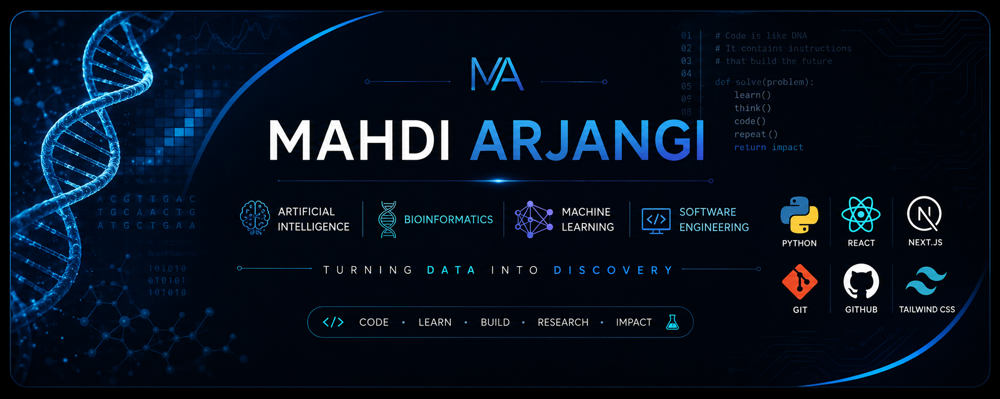

<div align="center">



# Hi, I'm Mahdi Arjangi 👋

### Computer Engineering Student • Front-End Developer • Future AI & Bioinformatics Researcher

<p>
  <a href="mailto:mahdiarjangi1383@gmail.com">
    
  </a>

  

  

  

  

</p>

</div>

---

# 👨‍💻 About Me

I'm a **Computer Engineering student** with a strong passion for **Artificial Intelligence**, **Bioinformatics**, and **Software Engineering**.

Alongside my studies, I work as a **Front-End Developer**, building production web applications using modern technologies.

My current focus is transitioning from software engineering into **AI-driven Bioinformatics research**, with the long-term goal of pursuing a **fully funded Master's or PhD**.

---

# 🚀 Current Journey

```text
Computer Engineering
        │
        ▼
Professional Front-End Development
        │
        ▼
Python & Data Science
        │
        ▼
Machine Learning
        │
        ▼
Bioinformatics
        │
        ▼
Research & Graduate School
```

---

# 📍 What I'm Working On

- 💼 Developing production web applications with React & Next.js
- 🧠 Transitioning from Software Engineering to AI & Bioinformatics
- 🐍 Strengthening Python for Machine Learning and scientific computing
- 📊 Learning Data Science through hands-on projects
- 🎓 Preparing for a fully funded Master's/PhD

---

# 💼 Professional Experience

### Front-End Developer

Working on real-world applications including:

🛒 Economic Labbaik E-Commerce Platform

🏢 AnaMard Attendance Management System

### Daily Technologies

<p align="left">


</p>

---

# 🧠 Research Interests

- Artificial Intelligence
- Bioinformatics
- Machine Learning
- Data Science
- Computational Biology
- Gene Expression Analysis
- Medical AI

---

# 🛠 Tech Stack

### Languages

<p>


</p>

### Frameworks

<p>


</p>

### Tools

<p>


</p>

---

# 🌱 Currently Learning

- NumPy
- Pandas
- Scikit-learn
- Machine Learning
- Data Visualization
- Bioinformatics
- Scientific Programming

---

# 🎯 2026 Goals

- ✅ Become highly proficient in Python
- 🔄 Master Machine Learning fundamentals
- 🔄 Learn Bioinformatics deeply
- 🔄 Build research-oriented projects
- 🔄 Publish my first scientific paper
- 🔄 Achieve IELTS 7+
- 🔄 Get admitted to a fully funded graduate program

---

# 📂 Featured Projects

Coming soon...

- Python for Data Science
- Machine Learning Algorithms
- Bioinformatics Toolkit
- Gene Expression Analysis
- Data Visualization
- Research Projects

---

# 🔥 GitHub Streak

<p align="center">


</p>

---

# 📈 Contribution Graph

<p align="center">


</p>

---

# 📫 Contact

📧 **mahdiarjangi1383@gmail.com**

---

<div align="center">

## "Turning Data Into Discovery"

*Code • Learn • Build • Research • Impact*

</div>
